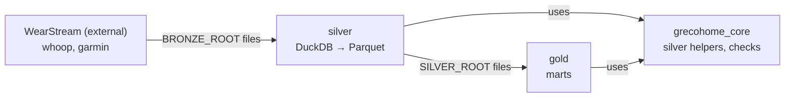

# High-Level Design: grecohome-dagster

LID runs in **Scoped** mode here. Under the arrow: the silver layer (`packages/silver/**`),
the gold layer (`packages/gold/**`), and the shared core's check helpers and silver helpers
(`grecohome_core.checks`, `grecohome_core.silver`). Sections that describe other parts of the
system are short orientation summaries. The detailed design for those parts lives in
`docs/ARCHITECTURE.md`.

## Problem

Personal health data (Whoop, Garmin) is spread across vendor APIs. Those APIs restate history,
sync late and sometimes go away. Capturing a durable raw record of everything each source
returned is one job; turning that record into typed, joined views for analysis is another. This
repo does the second.

## Approach

A three-layer lake. This repo owns the two derived layers, orchestrated by self-hosted Dagster:

- **Bronze**: raw source responses as immutable, append-only files under `BRONZE_ROOT`, the
  only source of truth. Bronze is written entirely outside this repo, by **WearStream**
  (`chainringlabs/wearstream`), which captures Whoop and Garmin. This repo only reads it.
- **Silver**: one cross-subject code location. Builds typed, deduplicated Parquet from bronze
  (DuckDB), fully rebuilt each run.
- **Gold**: one code location of analysis marts built from silver, fully rebuilt each run.

Each layer ships as its own gRPC code-location image registered with the host's Dagster
instance. Cross-layer lineage is declared by `AssetKey`. The reads are filesystem reads of
the upstream root.

## Target Users

A single user (`user_id=1`) who owns the data, runs the host and reads the marts and
dashboards. No multi-user or tenant scaling.

## Goals

- Silver and gold can be dropped and regenerated from bronze at any time.
- Silver carries everything bronze holds that a table models, including data the source
  synced or restated after the fact.
- Failures surface through asset checks and alerting rather than silent gaps.

## Non-Goals

- Capturing from any source. Bronze capture, credentials and bronze-level checks belong to
  WearStream.
- No transactional database (no Postgres, SQLAlchemy, Alembic) for lake data.
- No location, geocode, glucose or weather processing.
- No multi-user support.
- Shipping a Dagster instance or webserver. Only code locations ship.

## Tenets

Ordered. The higher tenet wins a conflict.

- **Completeness over economy.** When keeping more of what bronze holds (rows, restatements,
  columns a table models) and a smaller or cheaper table pull in opposite directions, keep the
  more complete table.
- **Shared core, table-specific overrides.** Put reading, dedup, writing and check behavior in
  `grecohome_core` and have each silver or gold table use it. Add table-specific logic only
  where that table's data demands it, and write down why in the table's design doc.

## System Design

## Components under the arrow

| Component | Design | Role |
|---|---|---|
| Shared core (check helpers, silver helpers) | `docs/intent/core/` | The read/dedup/write helpers silver and gold are built from, and the alerting, checks-job and table-freshness helpers their checks use |
| Silver | `docs/intent/silver/` | Typed, deduplicated Parquet projections of bronze, one table family per child doc |
| Gold | `docs/intent/gold/` | Analysis marts built from silver, and the instance-wide run monitors that ship in the gold code location |

Layers depend on the shared core, never the reverse. So a change to a core contract is a
cross-segment change: it cascades to every silver and gold spec that relies on it.

Whoop and Garmin capture, authentication, the bronze layout and bronze checks are designed in
the WearStream repo, not here. This repo's intent starts at the bronze files silver reads.

## Key Design Decisions

- **Bronze is an external, read-only input.** WearStream is one self-scheduling container that
  owns Whoop and Garmin end to end: OAuth and session handling, trailing-window re-capture,
  skip-identical, backfill, its own bronze checks and its own alerts. It writes `whoop/` and
  `garmin/` under `BRONZE_ROOT`. The bronze tree is mounted read-only in the silver container.
  - **The bronze layout is a read contract owned by WearStream:**
    `{source}/{collection}/dt=YYYY-MM-DD/` folders holding payload files named with a 13-digit
    fetch time, each beside a `.meta.json` sidecar, at `schema_version` `v1`. Silver's readers
    depend on exactly this. A layout change is a WearStream release first, then a silver change
    before silver can rely on it.
  - **Lineage without a producer location.** Silver declares lineage on the Whoop and Garmin
    bronze `AssetKey`s (`whoop_bronze_*`, `garmin_bronze_*`). No code location defines those
    keys, so Dagster shows them as external stubs. Silver runs on its own schedules and never
    waits on a bronze materialization event.
  - **Rejected alternative:** capturing Whoop and Garmin in Dagster code locations. That ties
    two credential lifecycles (Whoop's rotating refresh token, Garmin's session) to the Dagster
    host's availability and upgrade cadence, and two refreshers on one Whoop grant revoke it, so
    exactly one producer may own each source.
- **There is no transactional database.** Silver and gold are Parquet files written through
  DuckDB, fully rebuilt each run. No Postgres, SQLAlchemy, Alembic or APScheduler. The rejected
  alternative, parsed rows in Postgres with incremental upserts, needs a database to run,
  migrate and pool, and an incremental store drifts from bronze in ways a full rebuild can't.
- **Silver reads bronze as re-captured UTC fetch-slices.** Two properties of bronze shape every
  silver read:
  - **Partitions are UTC fetch-slices, not local days.** A `dt=` folder is the fetch window
    `[day 00:00Z, next day 00:00Z)`. Local-day semantics ("day", "night") are applied in silver
    at read time over the payload's own timestamps, never inferred from the folder name.
  - **The same record may appear in many captures.** Sources sync late and restate history, so
    bronze holds every capture that differed from the one before. Silver resolves them by taking
    the latest capture per logical key, and tolerates a record appearing in several folders.
- **Dagster is pinned to the host, and each layer ships its own code location.**
  - **Pins:** `dagster` and every `dagster-*` package are pinned `==` to the host's versions,
    because the daemon and webserver talk to code locations over a version-coupled gRPC
    protocol. A patch mismatch fails code-location loading with opaque gRPC errors. So these
    pins change deliberately, in lockstep with the host: Renovate proposes them as one grouped PR and never merges it. Other
    libraries are pinned `==`; pure-data packages (`tzdata`) use `>=`.
  - **The gRPC stack floats.** `grpcio`, `grpcio-health-checking` and `protobuf` arrive
    through Dagster and are resolved by the lock, not pinned: gRPC is wire-compatible across
    library versions, so only the Dagster version couples an image to the host. What must
    agree is the pairing *inside* one image, because generated protobuf code refuses to load
    under an older protobuf runtime and that stops the code server at startup. Package
    metadata normally enforces the pairing; a CI smoke test imports the modules the code
    server loads at startup, so a release that mis-declares it fails the build instead of
    the deployment.
  - **Code locations:** each layer is its own gRPC code-location image
    (`ghcr.io/tgrecojr/grecohome-dagster-<layer>`), registered in the host's
    `workspace.yaml`. This repo ships code locations only, never a Dagster instance, webserver
    or `dagster.yaml`. Layers deploy and fail independently, and adding one means adding it to
    the CI image matrix and the workspace. Upgrading Dagster is a coordinated, manual step
    across the host and every image.
- **Logs never carry credentials.** Logs ship to Loki, which keeps them for weeks and is
  readable by anything with Grafana access. So no code location may write a token, client
  secret or password to a log line, including inside a rendered traceback. The shared logger in
  `grecohome_core.logging_config` renders tracebacks **without local variables** in every code
  location, whether or not that code location configures logging explicitly. Apart from that,
  its safe defaults keep structlog's own output format (no color codes when output isn't a
  terminal), so the Loki queries and alerts that match log text keep working. Relying on each
  code location to call a setup function was rejected: a missed call fails silently, open.
- **Failures page through Loki and Grafana to Slack.** Self-hosted Dagster OSS has no push
  alerting, so page-worthy conditions emit distinct structured log lines, which ship to Loki,
  and Grafana alert rules route them to a Slack contact point. The signals are:
  - `asset_check_failed`, from any failing ERROR asset check in silver or gold,
  - `dagster_run_failed`, from a run-failure sensor in the gold code location that watches every
    code location, so a failed run pages when it fails rather than when a freshness check
    notices,
  - `run_queue_backed_up`, from a queue-depth monitor in the gold code location.

  WARN-level check failures stay in the Dagster UI and don't page. WearStream pages through
  the same Loki → Grafana → Slack path on its own `ERROR` lines, by rules that belong to its
  deployment rather than to this repo. The Slack credential
  lives only in Grafana, never in this repo. A "Data Platform Health" Grafana dashboard
  shows the same signals.
- **Build schedules start stopped; checks schedules start running.**
  - **Build** schedules (anything that rebuilds a table) are switched on by hand once per code
    location after its first deploy. Forgetting to enable one is loud: tables go stale, and the
    table-freshness checks page.
  - **Checks** schedules and the **run monitors** start running, because forgetting to enable a
    safety net is silent.

  Dagster keeps a schedule's on/off state from the UI over its code default, so either way the
  choice is made once per code location. `docs/DEPLOYMENT.md` lists exactly what to enable.
- **Layers are append-only or rebuildable.** Bronze is never modified by the layers above it,
  and silver and gold never write under the layer below them (enforced by `protected_root`).

## Success Metrics

*(not yet specified at project level.)*

## References

- `docs/ARCHITECTURE.md`
- `docs/intent/core/`: the silver helpers and check helpers
- `docs/intent/silver/`: the silver layer and its table families
- `docs/intent/gold/`: the gold layer, its marts and the run monitors
- `https://github.com/chainringlabs/wearstream`: Whoop and Garmin capture, the sole producer of
  `BRONZE_ROOT`
