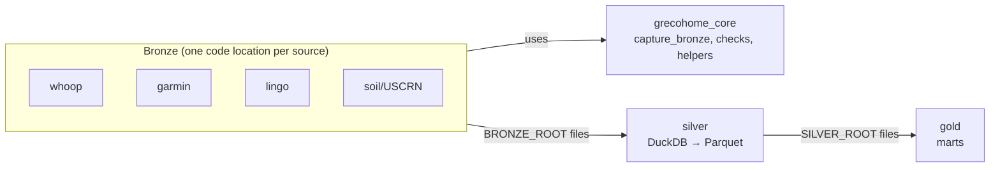

# High-Level Design: grecohome-dagster

LID runs in **Scoped** mode here. Only the Garmin bronze subject (`packages/garmin/**`)
is under the arrow. Sections that describe other parts of the system are short
orientation summaries. The detailed design for those parts lives in `docs/ARCHITECTURE.md`,
`docs/BRONZE.md`, `docs/SILVER.md`, `docs/GOLD.md` and `docs/adr/`.

## Problem

Personal health and environment data (Whoop, Garmin, Lingo glucose, USCRN soil/weather) is
spread across vendor APIs. Those APIs restate history, sync late, rotate credentials and
sometimes go away. Analysis needs one durable, complete local record of everything each
source returned, plus typed, joined views built on top of it.

## Approach

A three-layer lake orchestrated by self-hosted Dagster:

- **Bronze**: one code location per source. Each captures raw source responses as immutable,
  append-only files. Bronze is the only source of truth.
- **Silver**: one cross-subject code location. Builds typed, deduplicated Parquet from bronze
  (DuckDB), fully rebuilt each run.
- **Gold**: one code location of analysis marts built from silver, fully rebuilt each run.

Each layer ships as its own gRPC code-location image registered with the host's Dagster
instance. Cross-layer lineage is declared by `AssetKey`. The reads are filesystem reads of
the upstream root.

## Target Users

A single user (`user_id=1`) who owns the data, runs the host and reads the marts and
dashboards. No multi-user or tenant scaling.

## Goals

- Bronze holds the most complete record each source will give, including data the source
  syncs or corrects after the fact.
- Silver and gold can be dropped and regenerated from bronze at any time.
- Failures surface through asset checks and alerting rather than silent gaps.

## Non-Goals

- No transactional database (no Postgres, SQLAlchemy, Alembic) for lake data.
- No location or geocode processing.
- No multi-user support.
- Shipping a Dagster instance or webserver. Only code locations ship.

## Tenets

Ordered. The higher tenet wins a conflict.

- **Completeness over economy.** When more complete data and lower storage or API cost pull
  in opposite directions, keep the more complete data.
- **Shared core, source-specific overrides.** Put behavior in `grecohome_core` and have each
  source use it. Add source-specific logic only where that source's data demands it, and
  write down why in the source's design doc.

## System Design

Bronze partitions are UTC fetch-slices, not local days. Local-day and event-date semantics
are applied in silver at read time.

## Key Design Decisions

- **Bronze re-captures a trailing window; it does not capture each day once.** Sources sync
  late and restate history: Whoop rescores, Garmin back-fills data days after the fact, and
  NOAA back-corrects USCRN files. Each bronze schedule therefore re-pulls a trailing window of
  recent partitions. Every capture that differs from what bronze already holds is kept. Silver
  resolves multiple captures by taking the latest one per key. The alternative, capturing each
  partition exactly once, freezes each day at its first and often incomplete pull, which
  violates *Completeness over economy*.
- **Skip-identical dedup controls the cost of re-capture.** The core writer can skip a payload
  whose sha256 matches the newest capture already in that partition folder (`dedupe=True`). A
  re-capture costs an API call but no storage unless the source returned something new. This
  never drops data, because only byte-identical payloads are skipped.
- **Layers are append-only or rebuildable.** Bronze is never modified by the layers above it,
  and silver and gold never write under the layer below them (enforced by `protected_root`).

## Success Metrics

*(not yet specified at project level. See the Garmin capture LLD for scope-specific
criteria.)*

## References

- `docs/ARCHITECTURE.md`, `docs/BRONZE.md`, `docs/SILVER.md`, `docs/GOLD.md`
- `docs/adr/`: per-source and per-table architecture decision records
