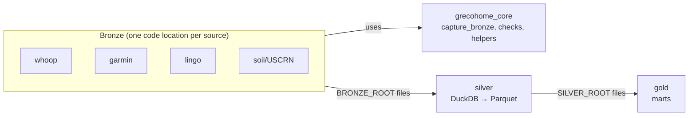

# High-Level Design: grecohome-dagster

LID runs in **Scoped** mode here. Under the arrow: the Garmin, Whoop and Soil/USCRN bronze
subjects (`packages/garmin/**`, `packages/whoop/**`, `packages/soil/**`), and the shared core's bronze writer and bronze
checks (`grecohome_core.bronze`, `grecohome_core.checks`). Sections that describe other parts of the system are short
orientation summaries. The detailed design for those parts lives in `docs/ARCHITECTURE.md`,
`docs/SILVER.md`, `docs/GOLD.md` and `docs/adr/`.

## Problem

Personal health and environment data (Whoop, Garmin, Lingo glucose, USCRN soil/weather) is
spread across vendor APIs. Those APIs restate history, sync late, rotate credentials and
sometimes go away. Analysis needs one durable, complete local record of everything each
source returned, plus typed, joined views built on top of it.

## Approach

A three-layer lake orchestrated by self-hosted Dagster:

- **Bronze**: one code location per source. Each captures raw source responses as immutable,
  append-only files. Bronze is the only source of truth.
- **Silver**: one cross-subject code location. Builds typed, deduplicated Parquet from bronze
  (DuckDB), fully rebuilt each run.
- **Gold**: one code location of analysis marts built from silver, fully rebuilt each run.

Each layer ships as its own gRPC code-location image registered with the host's Dagster
instance. Cross-layer lineage is declared by `AssetKey`. The reads are filesystem reads of
the upstream root.

## Target Users

A single user (`user_id=1`) who owns the data, runs the host and reads the marts and
dashboards. No multi-user or tenant scaling.

## Goals

- Bronze holds the most complete record each source will give, including data the source
  syncs or corrects after the fact.
- Silver and gold can be dropped and regenerated from bronze at any time.
- Failures surface through asset checks and alerting rather than silent gaps.

## Non-Goals

- No transactional database (no Postgres, SQLAlchemy, Alembic) for lake data.
- No location or geocode processing.
- No multi-user support.
- Shipping a Dagster instance or webserver. Only code locations ship.

## Tenets

Ordered. The higher tenet wins a conflict.

- **Completeness over economy.** When more complete data and lower storage or API cost pull
  in opposite directions, keep the more complete data.
- **Shared core, source-specific overrides.** Put behavior in `grecohome_core` and have each
  source use it. Add source-specific logic only where that source's data demands it, and
  write down why in the source's design doc.

## System Design

Bronze partitions are UTC fetch-slices, not local days. Local-day and event-date semantics
are applied in silver at read time.

## Components under the arrow

| Component | Design | Role |
|---|---|---|
| Shared core (bronze writer, bronze checks) | `docs/intent/core/` | The capture and data-quality contracts every bronze subject relies on |
| Garmin | `docs/intent/garmin/` | Garmin Connect bronze subject (capture, authentication) |
| Whoop | `docs/intent/whoop/` | Whoop bronze subject (capture, token lifecycle) |
| Soil/USCRN | `docs/intent/soil/` | NOAA USCRN station bronze subject (day-slice capture, late corrections) |

Subjects depend on the shared core, never the reverse. So a change to a core contract is a
cross-segment change: it cascades to every subject spec that relies on it.

## Key Design Decisions

- **Bronze captures only; there is no transactional database.** Each bronze subject calls its
  source and writes the raw responses to files under `BRONZE_ROOT`, which is the subject's only
  hard dependency. No Postgres, SQLAlchemy, Alembic or APScheduler. Reconciliation (records the
  source later rescored or deleted) isn't done by deleting rows at capture time. Bronze only
  appends, and silver resolves rescores and deletions at read time. The rejected alternative is
  writing parsed rows to Postgres with a windowed delete-reconcile: it needs a database to run,
  migrate and pool, and it destroys the record of what the source actually returned.
- **Bronze partitions are daily UTC fetch-slices.** A partition is the fetch window
  `[day 00:00Z, next day 00:00Z)`, not a semantic local day. Local-day semantics ("day",
  "night") are applied at read time over bronze's raw timestamps, never inferred from the
  partition key. Each subject chooses whether the in-progress day is a partition (`end_offset`).
  Backfill is a Dagster partition backfill over the same assets; there's no separate backfill
  script.
- **Dagster is pinned to the host, and each subject ships its own code location.**
  - **Pins:** `dagster` and every `dagster-*` package are pinned `==` to the host's versions,
    because the daemon and webserver talk to code locations over a version-coupled gRPC
    protocol. A patch mismatch fails code-location loading with opaque gRPC errors. So these
    pins change deliberately, in lockstep with the host, and Renovate doesn't bump them. Other
    libraries are pinned `==`; pure-data packages (`tzdata`) use `>=`.
  - **Code locations:** each subject and layer is its own gRPC code-location image
    (`ghcr.io/tgrecojr/grecohome-dagster-<subject>`), registered in the host's
    `workspace.yaml`. This repo ships code locations only, never a Dagster instance, webserver
    or `dagster.yaml`. Subjects deploy and fail independently, and adding a subject means
    adding it to the CI image matrix and the workspace. Upgrading Dagster is a coordinated,
    manual step across the host and every image.
  - **Concurrency pools:** limits (such as `whoop_api` and `garmin_api`) are set on the host
    instance with `dagster instance concurrency set <pool> <limit>`, not in the image; assets
    only tag their pool. Dagster 1.13 can't name a per-pool limit in `dagster.yaml`.
- **Bronze re-captures a trailing window; it does not capture each day once.** Sources sync
  late and restate history: Whoop rescores, Garmin back-fills data days after the fact, and
  NOAA back-corrects USCRN files. Each bronze schedule therefore re-pulls a trailing window of
  recent partitions. Every capture that differs from what bronze already holds is kept. Silver
  resolves multiple captures by taking the latest one per key. The alternative, capturing each
  partition exactly once, freezes each day at its first and often incomplete pull, which
  violates *Completeness over economy*.
- **Skip-identical dedup controls the cost of re-capture.** The core writer can skip a payload
  whose sha256 matches the newest capture already in that partition folder (`dedupe=True`). A
  re-capture costs an API call but no storage unless the source returned something new. This
  never drops data, because only byte-identical payloads are skipped.
- **Logs never carry credentials.** Logs ship to Loki, which keeps them for weeks and is
  readable by anything with Grafana access. So no code location may write a token, client
  secret or password to a log line, including inside a rendered traceback. This is enforced
  in two places:
  - Credential-handling paths log status and error type only, never `exc_info`.
  - The shared logger in `grecohome_core.logging_config` renders tracebacks **without local
    variables** in every code location, whether or not that code location configures
    logging explicitly. Apart from that, its safe defaults keep structlog's own output format
    (no color codes when output isn't a terminal), so the Loki queries and alerts that match
    log text keep working.

  The second rule is the backstop for a stray `exc_info` on a path nobody thought of.
  Relying on each code location to call a setup function was rejected: a missed call fails
  silently, open.
- **Failures page through Loki and Grafana to Slack.** Self-hosted Dagster OSS has no push
  alerting, so page-worthy conditions emit distinct structured log lines, which ship to Loki,
  and Grafana alert rules route them to a Slack contact point. The signals are:
  - `asset_check_failed`, from any failing ERROR asset check in any layer,
  - the Whoop token-refresh failure lines,
  - `run_queue_backed_up`, from a scheduled queue-depth monitor in the gold code location.

  WARN-level check failures stay in the Dagster UI and don't page. The Slack credential
  lives only in Grafana, never in this repo. A "Data Platform Health" Grafana dashboard
  shows the same signals.
- **Capture schedules and sensors start stopped; checks schedules start running.**
  - **Capture** (anything that calls a source or builds a layer) is switched on by hand once per
    code location after its first deploy. A new subject may need credentials set up first, and
    forgetting to enable capture is loud: no data arrives, and the freshness checks page.
  - **Checks** schedules start running, because forgetting to enable a safety net is silent.

  Dagster keeps a schedule's on/off state from the UI over its code default, so either way the
  choice is made once per code location. `docs/DEPLOYMENT.md` lists exactly what to enable.
- **Layers are append-only or rebuildable.** Bronze is never modified by the layers above it,
  and silver and gold never write under the layer below them (enforced by `protected_root`).

## Success Metrics

*(not yet specified at project level. See the Garmin capture LLD for scope-specific
criteria.)*

## References

- `docs/ARCHITECTURE.md`, `docs/SILVER.md`, `docs/GOLD.md`
- `docs/intent/core/`: the bronze writer and bronze checks
- `docs/adr/`: per-source and per-table architecture decision records
